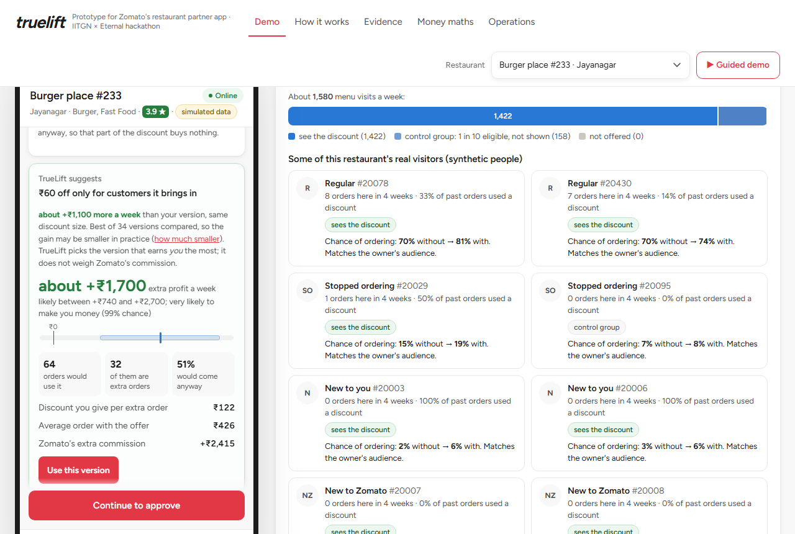

# TrueLift

[](https://github.com/YashG1836/truelift/actions/workflows/ci.yml)
[](LICENSE)


Restaurant discounts on Zomato are judged by the orders that **use** them, not the orders they
**create**. Since August 2026 a restaurant-funded offer starts only after the owner's OTP, so an
owner who cannot see whether an offer pays will stop approving it. TrueLift forecasts, targets and
measures each offer by the extra orders and profit it creates, inside that OTP flow.

Team Banana (IIT Gandhinagar): Yash Goyal, Bhavay Goyal, Kshitish Madbhavi. IITGN × Eternal hackathon, Round 2.

**Live demo: https://yashg1836.github.io/truelift/** · press **▶ Guided demo** for the ten-step story,
or open the evidence directly: https://yashg1836.github.io/truelift/#tab=evidence



## Three numbers (simulated market of 300 real Bengaluru listings, per week)

- **218 of 228** TrueLift offers pay for themselves, against **130 of 300** blanket offers.
- Restaurants make **+₹4.77 lakh** more than with no offers, against +₹2.46 lakh with blanket offers,
  while giving **₹5.94 lakh less discount**.
- Zomato's commission is higher too (+₹6.53 lakh against +₹6.45 lakh), and in every one of five
  market seeds, because offers that pay keep being approved.

Restaurant names and listings are real public 2019 data; every customer, order and rupee is simulated.

## Results

Generated from `reports/` by `scripts/render_tables.py`; every number in the documents is checked
against the reports by `scripts/check_claims.py` (do not edit by hand).

<!-- BEGIN:results-table -->
| | Today: same discount for everyone | Rule: new customers only | TrueLift |
|---|---|---|---|
| Offers that pay for themselves | 130 of 300 | 214 of 300 | **218 of 228** |
| Offers that lose money | 170 | 86 | **10** |
| Restaurants' profit from their own offers | +₹6.94 lakh | +₹7.16 lakh | **+₹7.89 lakh** |
| Restaurant profit vs no offers (market) | +₹2.46 lakh | +₹3.80 lakh | **+₹4.77 lakh** |
| Discount given | ₹16.71 lakh | **₹10.72 lakh** | ₹10.77 lakh |
| Zomato commission vs no offers | +₹6.45 lakh | +₹5.79 lakh | **+₹6.53 lakh** |
<!-- END:results-table -->

<!-- BEGIN:seeds-table -->
| Mean ± sd over 5 market seeds | Today: same discount for everyone | Rule: new customers only | TrueLift |
|---|---|---|---|
| Offers that pay for themselves | 132 ± 4 | 210 ± 4 | 223 ± 8 |
| Restaurants' profit from their own offers | +₹6.90 lakh ± 0.06 | +₹7.20 lakh ± 0.04 | +₹7.84 lakh ± 0.07 |
| Restaurant profit vs no offers (market) | +₹2.39 lakh ± 0.06 | +₹3.81 lakh ± 0.03 | +₹4.78 lakh ± 0.08 |
| Zomato commission vs no offers | +₹6.43 lakh ± 0.03 | +₹5.84 lakh ± 0.04 | +₹6.55 lakh ± 0.02 |
| Discount given | ₹16.84 lakh ± 0.08 | ₹10.83 lakh ± 0.08 | ₹10.79 lakh ± 0.18 |
<!-- END:seeds-table -->

The weekly measurement, the forecast check, placebo offers, the real-data checks (where the simple
"likely to act anyway" ranking wins too) and the limits are in
[`docs/method_and_evidence.md`](docs/method_and_evidence.md) and on the Evidence page.

## How it works

TrueLift adds four calls to the offer flow Zomato already has
([`docs/architecture.md`](docs/architecture.md), [`docs/integration_blueprint.md`](docs/integration_blueprint.md)):

1. **Quote**, on the OTP screen: a forecast of extra orders and profit with an 80% range, and a better
   version of the same discount (who sees it, minimum order, time, Brand Pack), or no offer.
2. **Serve**, when a customer opens the menu: a table lookup decides who sees the discount; a random
   one in ten eligible customers is held out, so the offer can be measured.
3. **Payout**: the restaurant pays for its own offer, itemised; Zomato co-funds only what it measures.
4. **Measure**, every week: the held-out customers against the rest, combined with the model, gives
   the extra profit with a range and a verdict on WhatsApp. A pause needs the offer's own evidence;
   renewal after four weeks needs a new OTP and shows what was measured.

## Three ways to run it

| | How | What you get |
|---|---|---|
| Public demo | Open the link above | The service's own answers for 32 restaurants and every design the create screen offers |
| Offline | `python tasks.py export` then `python scripts/build_offline.py`; open `dist/truelift-offline/index.html` or run `serve.py` inside it | The same demo with no internet |
| Live service | `uv sync`, `python tasks.py pipeline`, `python tasks.py serve` → http://localhost:8000 (API docs at `/docs`), or `docker compose up --build` | Any design, any restaurant, the real engine |

```bash
uv sync                       # pinned environment (or: pip install -r requirements-dev.txt)
python tasks.py pipeline      # about 15 minutes on 8 cores: simulate, train, evaluate -> reports/ and the model
python tasks.py serve         # the service and page at http://localhost:8000
python tasks.py test          # fast tests (about 20 s); --all adds the golden numbers and fuzzing
python tasks.py reproduce     # re-run the pipeline in a temporary folder and compare with reports/
python tasks.py realdata      # download Criteo and Hillstrom (checksummed) and rank their customers
```

Every command works on Windows, macOS and Linux (`tasks.py` needs only Python). Browser tests:
`cd tests/ui && npm ci && npx playwright install chromium && npx playwright test`.

## How we know

- **A market where the truth is known.** The simulator knows every customer's chance of ordering with
  and without each offer, so every forecast, range and verdict is checked against the truth
  ([`docs/simulator_datasheet.md`](docs/simulator_datasheet.md) lists every assumption).
- **Checks that can fail.** Placebo offers that must not pause, five market seeds, eight assumptions
  swept low and high, a benchmark of uplift learners, and experiments on what the model should and
  should not decide.
- **Real randomised data.** Criteo's advertising tests and Hillstrom's e-mail test, with the
  "likely to act anyway" baseline and intervals: the method wins on some and not on others, and
  we say so.
- **A self-audit.** 50 findings in our own work, each fixed and listed with the test or check that
  guards it ([`docs/what_we_tested.md`](docs/what_we_tested.md), [`CHANGELOG.md`](CHANGELOG.md)).

## Reading guide

| Start here | Then |
|---|---|
| [`docs/method_and_evidence.md`](docs/method_and_evidence.md): the problem, the method, the evidence, the limits | [`DEVLOG.md`](DEVLOG.md): what failed, what we changed, and the corrections with before and after |
| [`docs/integration_blueprint.md`](docs/integration_blueprint.md): calls, events, rollout, pilot size | [`docs/decisions/`](docs/decisions/): why each design choice |
| [`docs/privacy_and_fairness.md`](docs/privacy_and_fairness.md): what the model never reads, who gets discounts | [`docs/model_card.md`](docs/model_card.md), [`SECURITY.md`](SECURITY.md) |

## Limits

All outcomes are simulated; real numbers need Zomato's data, and the first step inside Zomato is a
shadow holdout on real offers. The real-data checks are advertising and e-mail, not food discounts.
The suggested version's stated advantage runs well above its true advantage, and the weekly
estimate leans on the model while a restaurant's own control group is small. Not modelled:
competitors reacting, kitchen capacity, delivery fees, habits that change over months.

## Data and licence

- Restaurants: Kaggle "Zomato Bangalore Restaurants" (2019), public listing fields only, for 300
  restaurants (`data/processed/restaurants.csv`, already built).
- Real-data checks: Criteo uplift v2.1 (CC BY-NC-SA 4.0) and the Hillstrom e-mail test, downloaded by
  `scripts/get_data.py` and checked against recorded SHA-256 hashes; never committed.
- Customers are synthetic. No real customer data is used anywhere.
- Code: MIT ([`LICENSE`](LICENSE), [`NOTICE`](NOTICE)). Not an official Zomato or Eternal product.
