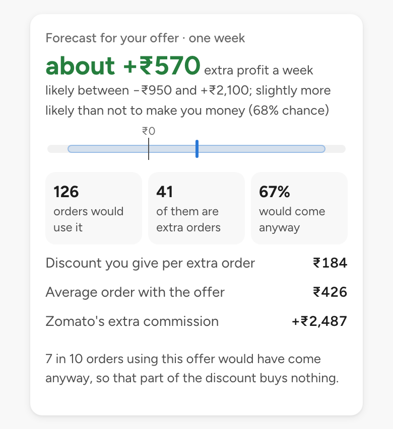
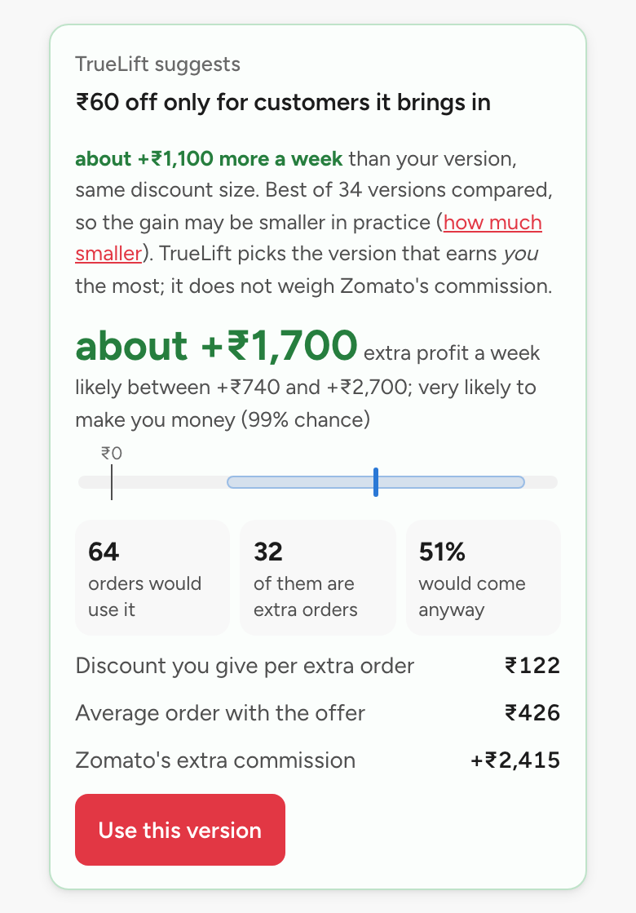
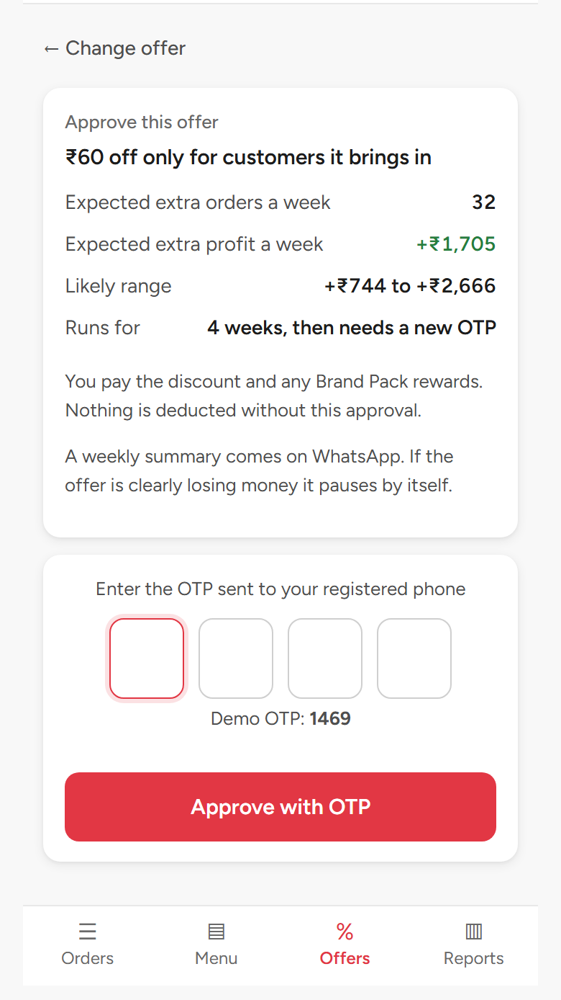
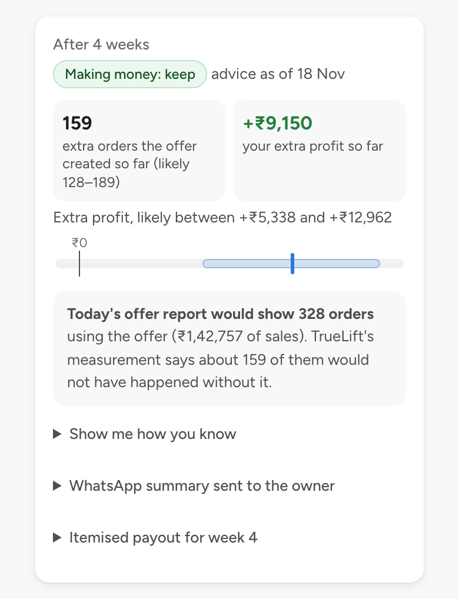
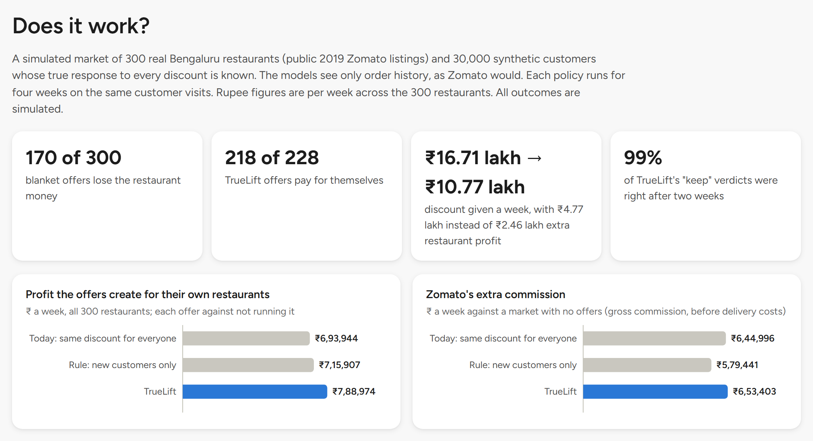
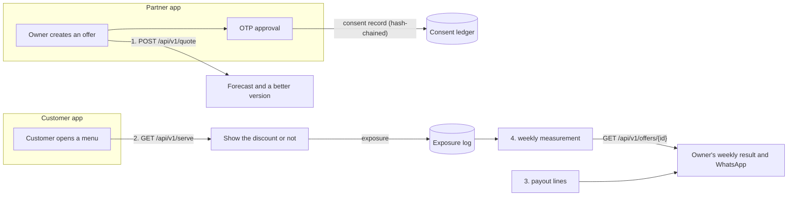

# TrueLift

[](https://github.com/YashG1836/truelift/actions/workflows/ci.yml)
[](LICENSE)


Restaurant discounts on Zomato are judged by the orders that **use** them, not the orders they
**create**. Since August 2026 a restaurant-funded offer starts only after the owner's OTP, so an
owner who cannot see whether an offer pays will stop approving it. TrueLift forecasts, targets and
measures each offer by the extra orders and profit it creates, inside that OTP flow.

Before the owner approves, TrueLift shows how many extra orders and how much profit the offer is
likely to bring, with a range, and suggests a better version of the same discount. While the offer
runs, it shows the discount only to customers it is likely to bring in, and holds out a random one
in ten of them so that the offer can be measured. Every week it reports what the offer really added
and advises the owner to keep, change or stop it.

**[Open the live demo](https://yashg1836.github.io/truelift/)** and press **▶ Guided demo** for the
ten-step story · [Evidence page](https://yashg1836.github.io/truelift/#tab=evidence) ·
[recording of the guided demo](docs/pitch/demo.mp4) ·
[offline copy](https://github.com/YashG1836/truelift/releases/tag/v2.0.0) ·
[pitch deck (PDF)](docs/pitch/TrueLift_deck.pdf)

Team Banana (IIT Gandhinagar): Yash Goyal, Bhavay Goyal, Kshitish Madbhavi. IITGN × Eternal
hackathon, Round 2. Restaurant names and listing details are real public 2019 data; every customer,
order and rupee is simulated.


*The guided demo, one frame per step. The restaurant is a real 2019 listing shown with a generic
name; its customers and money are simulated.*

## The problem in one picture


Take a ₹60-off offer on ₹400 orders that 100 orders used in a week. Today's offer report shows those
100. But 70 of them were regulars who would have ordered anyway at full price, so the restaurant
gave away ₹4,200 for nothing and ends the week ₹210 worse off than with no offer. An offer like this
pays for itself only if at least 32 of every 100 orders using it are truly extra. Nobody measures
that today; TrueLift does. The arithmetic is in `truelift/economics.py` and on the demo's Money
maths page.

## What the owner sees

<p>
  
  
  
  
</p>

1. **Before approval.** The owner's usual offer, ₹60 off for everyone, with its forecast: the extra
   orders and profit, a likely range, and how many of the orders using it would have come anyway.
2. **A better version of the same discount.** TrueLift compares about 34 versions (who sees it, the
   minimum order, the time of day, the Brand Pack reward for regulars) and suggests the one that
   earns the restaurant the most. The size of the discount stays the owner's choice.
3. **The OTP approval.** The owner approves exactly what was shown: the forecast, its range, four
   weeks, and who pays. The approval is stored in a hash-chained ledger, so every deduction can be
   checked later.
4. **Every week.** What the offer really added, with a range and a verdict, beside what today's
   offer report would show. "Show me how you know" compares the customers who saw the offer with
   those held out.


Zomato's side of the same offer. Each time a customer opens the menu, a table lookup decides whether
to show the discount. Regulars who would order anyway do not get it, and a random one in ten
eligible customers is held out: that control group is what makes the weekly measurement possible.
The visitors are synthetic people.

## Results

In a simulated market of 300 real Bengaluru listings, per week:

- **218 of 228** TrueLift offers pay for themselves, against **130 of 300** blanket offers.
- Restaurants make **+₹4.77 lakh** more than with no offers, against +₹2.46 lakh with blanket offers,
  while giving **₹5.94 lakh less discount**.
- Zomato's commission is higher too (+₹6.53 lakh against +₹6.45 lakh), and in every one of five
  market seeds, because offers that pay keep being approved.

The tables are generated from `reports/` by `scripts/render_tables.py`, and every number in the
documents is checked against the reports by `scripts/check_claims.py` (do not edit them by hand).

<!-- BEGIN:results-table -->
| | Today: same discount for everyone | Rule: new customers only | TrueLift |
|---|---|---|---|
| Offers that pay for themselves | 130 of 300 | 214 of 300 | **218 of 228** |
| Offers that lose money | 170 | 86 | **10** |
| Restaurants' profit from their own offers | +₹6.94 lakh | +₹7.16 lakh | **+₹7.89 lakh** |
| Restaurant profit vs no offers (market) | +₹2.46 lakh | +₹3.80 lakh | **+₹4.77 lakh** |
| Discount given | ₹16.71 lakh | **₹10.72 lakh** | ₹10.77 lakh |
| Zomato commission vs no offers | +₹6.45 lakh | +₹5.79 lakh | **+₹6.53 lakh** |
<!-- END:results-table -->

<details>
<summary>The same results across five market seeds</summary>

<!-- BEGIN:seeds-table -->
| Mean ± sd over 5 market seeds | Today: same discount for everyone | Rule: new customers only | TrueLift |
|---|---|---|---|
| Offers that pay for themselves | 132 ± 4 | 210 ± 4 | 223 ± 8 |
| Restaurants' profit from their own offers | +₹6.90 lakh ± 0.06 | +₹7.20 lakh ± 0.04 | +₹7.84 lakh ± 0.07 |
| Restaurant profit vs no offers (market) | +₹2.39 lakh ± 0.06 | +₹3.81 lakh ± 0.03 | +₹4.78 lakh ± 0.08 |
| Zomato commission vs no offers | +₹6.43 lakh ± 0.03 | +₹5.84 lakh ± 0.04 | +₹6.55 lakh ± 0.02 |
| Discount given | ₹16.84 lakh ± 0.08 | ₹10.83 lakh ± 0.08 | ₹10.79 lakh ± 0.18 |
<!-- END:seeds-table -->

</details>

<details>
<summary>The weekly measurement against the truth</summary>

The simulator knows each offer's true effect, so every weekly estimate can be checked. The control
group alone is too noisy for most restaurants, so TrueLift combines it with the model learned from
all restaurants, weighted by how noisy each is.

<!-- BEGIN:measurement-table -->
| After | Truth inside the 80% range | Average error: control group only | Model only | TrueLift combined | "Keep" verdicts truly positive |
|---|---|---|---|---|---|
| 1 week | 79% | ₹1,975 | ₹655 | ₹642 | 140 of 142 |
| 2 weeks | 87% | ₹2,892 | ₹1,220 | ₹1,166 | 113 of 114 |
| 4 weeks | 90% | ₹4,160 | ₹2,212 | ₹2,054 | 111 of 111 |
<!-- END:measurement-table -->

</details>



The demo's [Evidence page](https://yashg1836.github.io/truelift/#tab=evidence) shows the same
results, with the forecast check, placebo offers, owners declining approval, and Zomato's ledger.

**Real randomised data.** The targeting was also tested on Criteo's advertising tests and
Hillstrom's e-mail test, against the simple "likely to act anyway" ranking. It wins on some outcomes
and not on others, and we say so.

<details>
<summary>Share of all the extra response found in the top 30% of each ranking (90% interval)</summary>

<!-- BEGIN:realdata-table -->
| Dataset and outcome | Random | Likely to act anyway | S-learner | T-learner (TrueLift) | X-learner |
|---|---|---|---|---|---|
| Criteo, ads: visits | 29% (27% to 31%) | 84% (83% to 86%) | 85% (83% to 87%) | 84% (82% to 86%) | 85% (83% to 87%) |
| Criteo, ads: purchases | 30% (26% to 33%) | 92% (90% to 94%) | 63% (59% to 68%) | 72% (67% to 76%) | 85% (82% to 89%) |
| Hillstrom, women's e-mail: visits | 23% (9% to 34%) | 45% (33% to 58%) | 55% (44% to 71%) | 53% (39% to 66%) | 54% (40% to 70%) |
| Hillstrom, women's e-mail: purchases | 17% (−50% to 60%) | 55% (3% to 136%) | 41% (−19% to 101%) | 65% (13% to 111%) | 28% (−36% to 67%) |
| Hillstrom, women's e-mail: spend | 28% (−27% to 64%) | 24% (−27% to 62%) | 49% (20% to 118%) | 36% (−9% to 86%) | 22% (−26% to 54%) |
| Hillstrom, men's e-mail: visits | 28% (21% to 34%) | 38% (32% to 46%) | 40% (32% to 46%) | 39% (32% to 45%) | 35% (29% to 43%) |
| Hillstrom, men's e-mail: purchases | 19% (−6% to 39%) | 17% (−23% to 40%) | 51% (24% to 81%) | 25% (−3% to 51%) | 58% (34% to 90%) |
| Hillstrom, men's e-mail: spend | 24% (−24% to 74%) | 29% (−3% to 93%) | 12% (−61% to 52%) | 28% (−6% to 71%) | 27% (−30% to 66%) |
<!-- END:realdata-table -->

</details>

The method, every check and the limits are in
[`docs/method_and_evidence.md`](docs/method_and_evidence.md).

## How it works

TrueLift adds four calls to the offer flow Zomato already has
([`docs/architecture.md`](docs/architecture.md), [`docs/integration_blueprint.md`](docs/integration_blueprint.md)):



1. **Quote**, on the OTP screen: a forecast of extra orders and profit with a range, and a better
   version of the same discount (who sees it, minimum order, time, Brand Pack), or no offer.
2. **Serve**, when a customer opens the menu: a table lookup decides who sees the discount; a random
   one in ten eligible customers is held out, so the offer can be measured.
3. **Payout**: the restaurant pays for its own offer, itemised; Zomato co-funds only what it measures.
4. **Measure**, every week: the held-out customers against the rest, combined with the model, gives
   the extra profit with a range and a verdict on WhatsApp. A pause needs the offer's own evidence;
   renewal after four weeks needs a new OTP and shows what was measured.

## How we know

- **A market where the truth is known.** The simulator knows every customer's chance of ordering with
  and without each offer, so every forecast, range and verdict is checked against the truth
  ([`docs/simulator_datasheet.md`](docs/simulator_datasheet.md) lists every assumption).
- **Checks that can fail.** Placebo offers that must not pause, five market seeds, eight assumptions
  swept low and high, a benchmark of uplift learners, and experiments on what the model should and
  should not decide.
- **Real randomised data.** Criteo's advertising tests and Hillstrom's e-mail test, with the
  "likely to act anyway" baseline and intervals: the method wins on some and not on others, and
  we say so.
- **A self-audit.** 50 findings in our own work, each fixed and listed with the test or check that
  guards it ([`docs/what_we_tested.md`](docs/what_we_tested.md), [`CHANGELOG.md`](CHANGELOG.md)).

## Talking to restaurant owners

<p>
  
  
</p>

Every rupee above is simulated, so the team is also asking restaurant owners and managers what
they see today and whether they read TrueLift's numbers as intended, with the kit in
[`docs/field_research/`](docs/field_research/) (a consent script, question sheets in English with
Hindi and Gujarati drafts, and comprehension cards). The first interview took place on
17 November 2026: a team member talked the manager of a chain outlet in Gandhinagar through
TrueLift and showed the demo on a phone. Its note is not written up yet, so we report no finding
from it; findings go into [`docs/field_research.md`](docs/field_research.md) as counts, never
names. The photos are published with the manager's permission; other diners' faces and the
restaurant's name are blurred.

## Run it yourself

| | How | What you get |
|---|---|---|
| Public demo | Open the link above | The service's own answers for 32 restaurants and every design the create screen offers |
| Offline | Download `truelift-offline.zip` from the [v2.0.0 release](https://github.com/YashG1836/truelift/releases/tag/v2.0.0) and unzip it, or build it with `python tasks.py export` then `python scripts/build_offline.py`; open `index.html` or run `serve.py` inside it | The same demo with no internet |
| Live service | `uv sync`, `python tasks.py pipeline`, `python tasks.py serve` → http://localhost:8000 (API docs at `/docs`), or `docker compose up --build` | Any design, any restaurant, the real engine |

```bash
uv sync                       # pinned environment (or: pip install -r requirements-dev.txt)
python tasks.py pipeline      # about 15 minutes on 8 cores: simulate, train, evaluate -> reports/ and the model
python tasks.py serve         # the service and page at http://localhost:8000
python tasks.py test          # fast tests (about 20 s); --all adds the golden numbers and fuzzing
python tasks.py reproduce     # re-run the pipeline in a temporary folder and compare with reports/
python tasks.py realdata      # download Criteo and Hillstrom (checksummed) and rank their customers
python tasks.py screenshots   # retake the README's images from the exported demo (site/)
```

Every command works on Windows, macOS and Linux (`tasks.py` needs only Python). Browser tests:
`cd tests/ui && npm ci && npx playwright install chromium && npx playwright test`.

## What is in the repository

- `truelift/`: the service (money of an order, simulator, uplift model, engine, API) and the
  partner-app page in `truelift/static/`.
- `scripts/`: the pipeline, the experiments, the real-data checks, the static export, the claims
  check and the pitch files.
- `tests/`: tests by area, the golden numbers, contract fuzzing, and browser tests in `tests/ui/`.
- `reports/`: every number in the documents and the demo comes from a file here.
- `docs/`: the write-up, architecture, integration blueprint, model card, privacy and fairness,
  decision records, field research, the pitch, and the README's images in `docs/img/`.
- `data/processed/`: the 300 public listings and the committed model.

## Reading guide

| Start here | Then |
|---|---|
| [`docs/method_and_evidence.md`](docs/method_and_evidence.md): the problem, the method, the evidence, the limits | [`DEVLOG.md`](DEVLOG.md): what failed, what we changed, and the corrections with before and after |
| [`docs/integration_blueprint.md`](docs/integration_blueprint.md): calls, events, rollout, pilot size | [`docs/decisions/`](docs/decisions/): why each design choice |
| [`docs/privacy_and_fairness.md`](docs/privacy_and_fairness.md): what the model never reads, who gets discounts | [`docs/model_card.md`](docs/model_card.md), [`SECURITY.md`](SECURITY.md) |
| [`docs/pitch/`](docs/pitch/): the deck, a one-page summary, thirty questions with answers, the demo runbook | [`docs/field_research.md`](docs/field_research.md): the kit for interviewing restaurant owners, and the first interview |

## Limits

All outcomes are simulated; real numbers need Zomato's data, and the first step inside Zomato is a
shadow holdout on real offers. The real-data checks are advertising and e-mail, not food discounts.
One interview with a restaurant manager so far, and no findings from it yet. The suggested
version's stated advantage runs well above its true advantage, and the weekly estimate leans on the
model while a restaurant's own control group is small. Not modelled: competitors reacting, kitchen
capacity, delivery fees, habits that change over months.

## Data and licence

- Restaurants: Kaggle "Zomato Bangalore Restaurants" (2019), public listing fields only, for 300
  restaurants (`data/processed/restaurants.csv`, already built).
- Real-data checks: Criteo uplift v2.1 (CC BY-NC-SA 4.0) and the Hillstrom e-mail test, downloaded by
  `scripts/get_data.py` and checked against recorded SHA-256 hashes; never committed.
- Customers are synthetic. No real customer data is used anywhere.
- Interview photos: published with the manager's permission; bystanders and the restaurant's name
  blurred, no metadata (`docs/field_research/photos/`).
- Code: MIT ([`LICENSE`](LICENSE), [`NOTICE`](NOTICE)). Not an official Zomato or Eternal product.
