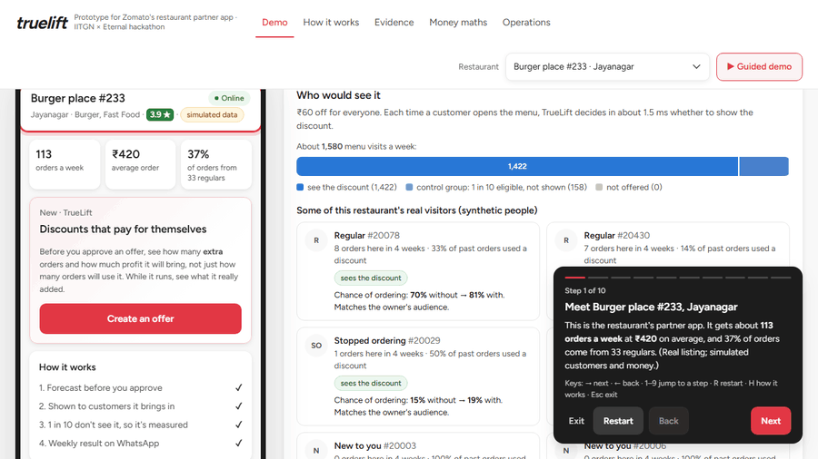
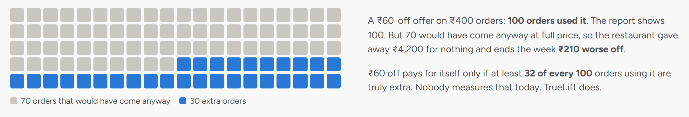
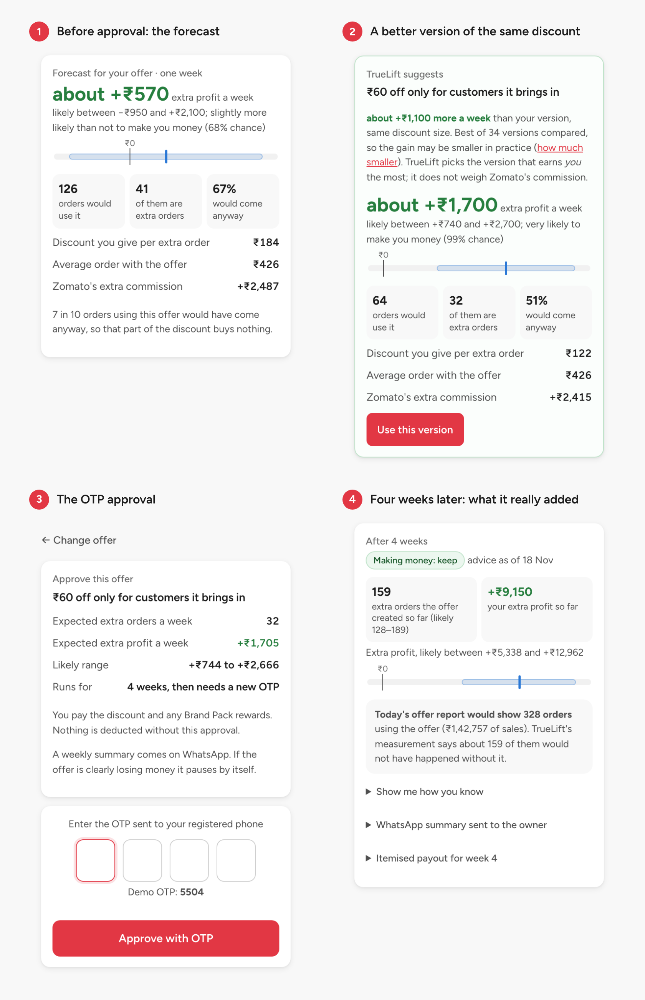
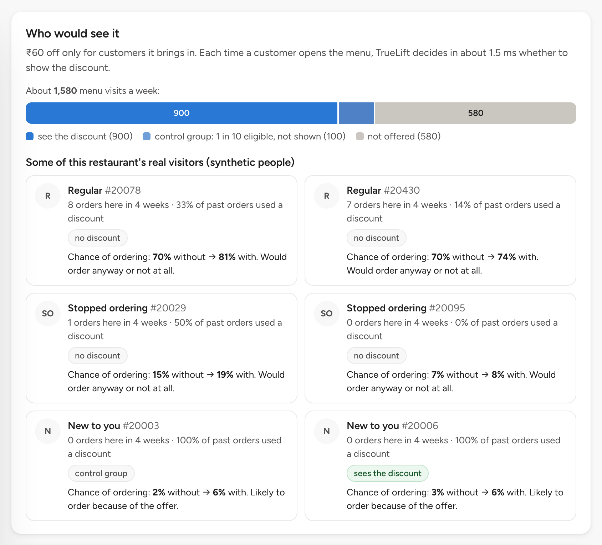
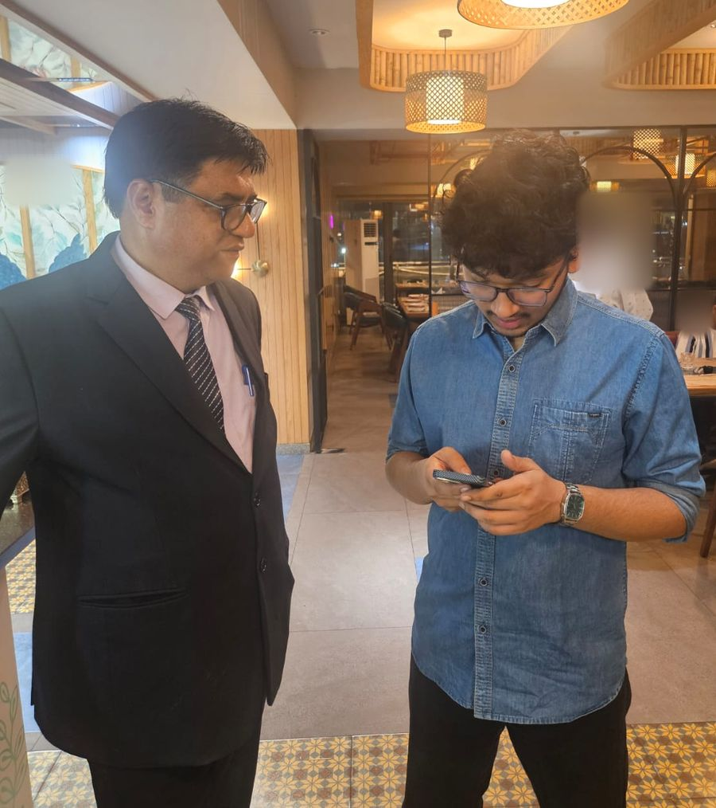

# TrueLift

[](https://github.com/YashG1836/truelift/actions/workflows/ci.yml)
[](LICENSE)


**Restaurant discounts on Zomato are judged by the orders that use them, not the orders they create.**
TrueLift forecasts, targets and measures every restaurant-funded offer by the extra orders and profit
it creates, inside the OTP approval that Zomato already asks owners for.

## Start here

- **[Live demo](https://yashg1836.github.io/truelift/)**: press **▶ Guided demo** for the ten-step story
  (→ next, ← back, Esc to leave), or pick a restaurant and create your own offer.
- **[Report](submission/TrueLift_Report.pdf)** (IEEE format, PDF): the problem, the method, the evidence
  and the limits, end to end.
- **[Presentation](submission/TrueLift_Presentation.pdf)** (PDF): the guided demo's story as slides.
- **[Demo video](submission/TrueLift_Demo.mp4)**: the guided demo, recorded with captions.
- **[Offline copy](https://github.com/YashG1836/truelift/releases/tag/v2.0.0)**: the demo as a zip that
  runs without internet.
- **[Submission folder](submission/)**: all of the above in one place, with every link.

Team Banana, IIT Gandhinagar: Yash Goyal, Bhavay Goyal, Kshitish Madbhavi. IITGN × Eternal hackathon,
Round 2. Restaurant names and listing details are real public 2019 data; every customer, order and
rupee is simulated, and every screen says so.



## The problem



Since August 2026 a restaurant-funded offer on Zomato starts only after the owner approves it with an
OTP. Take a ₹60-off offer on ₹400 orders that 100 orders used in a week. Today's offer report shows
those 100. But 70 of them were regulars who would have ordered anyway at full price, so the
restaurant gave away ₹4,200 for nothing and ends the week ₹210 worse off than with no offer. An offer
like this pays for itself only if at least 32 of every 100 orders using it are truly extra. No report
measures that today, so owners approve blind, or stop approving. TrueLift measures it.

## What the owner sees



1. **A forecast before approval:** the extra orders and profit the offer is likely to bring, with a
   range, and how many of the orders using it would have come anyway.
2. **A better version of the same discount:** TrueLift compares about 34 versions (who sees it, the
   minimum order, the time of day, a Brand Pack reward for regulars) and suggests the one that earns
   the restaurant the most. The size of the discount stays the owner's choice.
3. **The OTP approval** records exactly what the owner was shown, for four weeks, in a hash-chained
   ledger, so every deduction can be checked later.
4. **Every week:** what the offer really added, with a range and a verdict (keep, change or stop),
   beside what today's report would show, and on WhatsApp.

## Inside Zomato



TrueLift adds four calls to the offer flow Zomato already has. No new screens: the forecast sits on
the OTP screen, the result arrives on WhatsApp, and nothing changes in how customers order.

| Call | When | What it does |
|---|---|---|
| `POST /api/v1/quote` | The owner creates an offer | Forecast with a range, and a better version of the same discount, or no offer |
| `GET /api/v1/serve` | A customer opens the menu | A table lookup decides who sees the discount; a random 1 in 10 eligible customers is held out |
| Payout lines | Every week | The restaurant pays for its own offer, itemised; Zomato co-funds only what it measures |
| `GET /api/v1/offers/{id}` | Every week | Held-out against shown customers, combined with the model: extra profit with a range and a verdict |

The held-out customers see normal menu prices, never higher ones. They are the control group that
makes the weekly measurement possible. Details: [`docs/architecture.md`](docs/architecture.md) and
[`docs/integration_blueprint.md`](docs/integration_blueprint.md).

## Results

In a simulated market of 300 real Bengaluru listings, per week:

- **218 of 228** TrueLift offers pay for themselves, against **130 of 300** blanket offers.
- Restaurants make **+₹4.77 lakh** more than with no offers, against +₹2.46 lakh with blanket offers,
  while giving **₹5.94 lakh less discount**.
- Zomato's commission is higher too (+₹6.53 lakh against +₹6.45 lakh), and in every one of five
  market seeds, because offers that pay keep being approved.

<!-- BEGIN:results-table -->
| | Today: same discount for everyone | Rule: new customers only | TrueLift |
|---|---|---|---|
| Offers that pay for themselves | 130 of 300 | 214 of 300 | **218 of 228** |
| Offers that lose money | 170 | 86 | **10** |
| Restaurants' profit from their own offers | +₹6.94 lakh | +₹7.16 lakh | **+₹7.89 lakh** |
| Restaurant profit vs no offers (market) | +₹2.46 lakh | +₹3.80 lakh | **+₹4.77 lakh** |
| Discount given | ₹16.71 lakh | **₹10.72 lakh** | ₹10.77 lakh |
| Zomato commission vs no offers | +₹6.45 lakh | +₹5.79 lakh | **+₹6.53 lakh** |
<!-- END:results-table -->

<details>
<summary>Are the weekly numbers right? The estimate against the truth</summary>

The simulator knows each offer's true effect, so every weekly estimate can be checked. A restaurant's
own control group is too small to measure alone, so TrueLift combines it with the model learned from
all restaurants, each weighted by how precise it is.

<!-- BEGIN:measurement-table -->
| After | Truth inside the 80% range | Average error: control group only | Model only | TrueLift combined | "Keep" verdicts truly positive |
|---|---|---|---|---|---|
| 1 week | 79% | ₹1,975 | ₹655 | ₹642 | 140 of 142 |
| 2 weeks | 87% | ₹2,892 | ₹1,220 | ₹1,166 | 113 of 114 |
| 4 weeks | 90% | ₹4,160 | ₹2,212 | ₹2,054 | 111 of 111 |
<!-- END:measurement-table -->

</details>

<details>
<summary>Real randomised data: share of all the extra response found in the top 30% of each ranking</summary>

The same method, refitted on two public randomised experiments (Criteo's advertising tests,
Hillstrom's e-mail test). It wins on some outcomes and not on others, and we say so.

<!-- BEGIN:realdata-table -->
| Dataset and outcome | Random | Likely to act anyway | S-learner | T-learner (TrueLift) | X-learner |
|---|---|---|---|---|---|
| Criteo, ads: visits | 29% (27% to 31%) | 84% (83% to 86%) | 85% (83% to 87%) | 84% (82% to 86%) | 85% (83% to 87%) |
| Criteo, ads: purchases | 30% (26% to 33%) | 92% (90% to 94%) | 63% (59% to 68%) | 72% (67% to 76%) | 85% (82% to 89%) |
| Hillstrom, women's e-mail: visits | 23% (9% to 34%) | 45% (33% to 58%) | 55% (44% to 71%) | 53% (39% to 66%) | 54% (40% to 70%) |
| Hillstrom, women's e-mail: purchases | 17% (−50% to 60%) | 55% (3% to 136%) | 41% (−19% to 101%) | 65% (13% to 111%) | 28% (−36% to 67%) |
| Hillstrom, women's e-mail: spend | 28% (−27% to 64%) | 24% (−27% to 62%) | 49% (20% to 118%) | 36% (−9% to 86%) | 22% (−26% to 54%) |
| Hillstrom, men's e-mail: visits | 28% (21% to 34%) | 38% (32% to 46%) | 40% (32% to 46%) | 39% (32% to 45%) | 35% (29% to 43%) |
| Hillstrom, men's e-mail: purchases | 19% (−6% to 39%) | 17% (−23% to 40%) | 51% (24% to 81%) | 25% (−3% to 51%) | 58% (34% to 90%) |
| Hillstrom, men's e-mail: spend | 24% (−24% to 74%) | 29% (−3% to 93%) | 12% (−61% to 52%) | 28% (−6% to 71%) | 27% (−30% to 66%) |
<!-- END:realdata-table -->

</details>

Every table is generated from `reports/` by `scripts/render_tables.py`, and every number in the
documents is checked against the reports by `scripts/check_claims.py`.

## How we know

- **A market where the truth is known.** The simulator knows every customer's chance of ordering with
  and without each offer, so every forecast, range and verdict is checked against the truth
  ([`docs/simulator_datasheet.md`](docs/simulator_datasheet.md) lists every assumption).
- **Checks that can fail.** Placebo offers that must not be paused, five market seeds, eight
  assumptions swept low and high, a benchmark of uplift learners, and tests of what the model should
  and should not decide.
- **Real randomised data**, with the simple "likely to act anyway" ranking as the baseline (above).
- **A self-audit.** 50 findings in our own work, each fixed and guarded by a test
  ([`docs/what_we_tested.md`](docs/what_we_tested.md)).

## Talking to restaurant owners

<p>
  
  
</p>

Every rupee above is simulated, so we are also asking owners and managers what they see today and
whether they read TrueLift's numbers as intended ([field kit](docs/field_research/)). The first
interview took place on 17 November 2026 with the manager of a chain outlet in Gandhinagar. Its note
is not written up yet, so we report no finding from it ([`docs/field_research.md`](docs/field_research.md)).
The photos are published with the manager's permission; other diners' faces and the restaurant's
name are blurred.

## Run it yourself

| | How | What you get |
|---|---|---|
| Public demo | Open the link above | The service's own answers for 32 restaurants and every offer the create screen allows |
| Offline | Unzip `truelift-offline.zip` from the [v2.0.0 release](https://github.com/YashG1836/truelift/releases/tag/v2.0.0) and open `index.html` | The same demo with no internet |
| Live service | The commands below, then http://localhost:8000 (API docs at `/docs`), or `docker compose up --build` | Any restaurant, any offer, the real engine |

```bash
uv sync                       # pinned environment (or: pip install -r requirements-dev.txt)
python tasks.py pipeline      # about 15 minutes: simulate, train, evaluate -> reports/ and the model
python tasks.py serve         # the service and page at http://localhost:8000
python tasks.py test          # fast tests (about 20 s); --all adds the golden numbers and fuzzing
```

`tasks.py` needs only Python and works on Windows, macOS and Linux. `python tasks.py reproduce`
re-runs the pipeline and compares it with `reports/`; `python tasks.py realdata` repeats the
real-data checks.

## What is in the repository

| Path | What it is |
|---|---|
| [`truelift/`](truelift/) | The service: money of one order, simulator, uplift model, engine, API; the partner-app page in `static/` |
| [`scripts/`](scripts/) | The pipeline, experiments, real-data checks, static export, claims check, pitch files |
| [`tests/`](tests/) | Tests by area, golden numbers, contract fuzzing, browser tests in `tests/ui/` |
| [`reports/`](reports/) | Every number in the documents and the demo comes from a file here |
| [`docs/`](docs/) | The write-up and design documents (reading guide below) |
| [`submission/`](submission/) | Report, presentation, video and links, ready to submit |

Reading guide: [`docs/method_and_evidence.md`](docs/method_and_evidence.md) (the full write-up) ·
[`DEVLOG.md`](DEVLOG.md) (what failed and what we changed) ·
[`docs/integration_blueprint.md`](docs/integration_blueprint.md) (calls, events, rollout, pilot size) ·
[`docs/privacy_and_fairness.md`](docs/privacy_and_fairness.md) (what the model never reads) ·
[`docs/model_card.md`](docs/model_card.md) · [`docs/decisions/`](docs/decisions/) ·
[`docs/pitch/`](docs/pitch/) (speaker notes, runbook, thirty questions with answers).

## Limits

- All outcomes are simulated; real numbers need Zomato's data. The first step inside Zomato is a
  shadow holdout on offers owners already run.
- The real-data checks are advertising and e-mail, not food discounts.
- The suggested version's stated advantage runs well above its true advantage, and the weekly
  estimate leans on the model while a restaurant's own control group is small.
- Not modelled: competitors reacting, kitchen capacity, delivery fees, habits that change over months.

## Data and licence

Restaurants: Kaggle "Zomato Bangalore Restaurants" (2019), public listing fields only, for 300
restaurants. Real-data checks: Criteo uplift v2.1 (CC BY-NC-SA 4.0) and the Hillstrom e-mail test,
downloaded by `scripts/get_data.py` and checked against recorded hashes, never committed. Customers
are synthetic; no real customer data is used anywhere. Code: MIT ([`LICENSE`](LICENSE),
[`NOTICE`](NOTICE)). Not an official Zomato or Eternal product.
