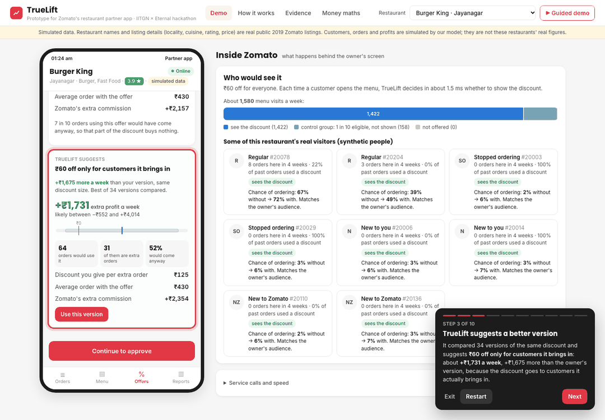

# TrueLift

Restaurant discounts on Zomato are judged by the orders that **use** them, not the orders they
**create**. TrueLift forecasts, targets and measures each restaurant-funded offer by the extra
orders and profit it creates, inside Zomato's existing offer flow (the owner's OTP approval).

Team Banana (IIT Gandhinagar): Yash Goyal, Bhavay Goyal, Kshitish Madbhavi.
## For judges

| | |
|---|---|
| Live demo | https://yashg1836.github.io/truelift/ (static copy of the service's answers; the full service runs locally, see below) |
| Write-up | [`TrueLift_Round2_Plan.md`](TrueLift_Round2_Plan.md): research, the money maths, how it works, evidence, limits |
| How we got here | [`DEVLOG.md`](DEVLOG.md): what failed, what we changed and why |
| Round 1 | [`docs/round1_problem_statement.pdf`](docs/round1_problem_statement.pdf) |

In the demo: pick a restaurant, create an offer, compare the forecast with the better version,
approve it with the OTP, then simulate four weeks. The panel on the right shows who sees the
discount and, because this is a simulation, the true effect next to TrueLift's estimate.



## Results in one table (simulated market, per week, 300 restaurants)

| | Today: same discount for everyone | Rule: new customers only | TrueLift |
|---|---|---|---|
| Offers that pay for themselves | 130 | 211 | **242** |
| Restaurant profit vs no offers | +₹2.46 lakh | +₹3.96 lakh | **+₹4.85 lakh** |
| Discount given | ₹16.7 lakh | ₹10.8 lakh | **₹10.0 lakh** |
| Zomato commission vs no offers | +₹6.45 lakh | +₹5.95 lakh | +₹6.38 lakh |

On real randomised data (Criteo's ad holdouts, 4.2M unseen users) the same model's top 30% picks
hold 84% of all the extra visits (Qini 0.34 vs 0.005 random). Details and limits: the plan, §6.

## Run it

```bash
python3 -m venv .venv && .venv/bin/pip install -r requirements.txt
.venv/bin/python scripts/build_restaurants.py   # needs data/raw/zomato_blr/zomato.csv (see below)
.venv/bin/python scripts/run_pipeline.py        # ~6 min: simulate, train, evaluate -> reports/
.venv/bin/uvicorn truelift.api:app --port 8000  # open http://localhost:8000
.venv/bin/python -m pytest -q                   # tests
.venv/bin/python scripts/export_static.py 142 283 97  # static demo -> site/ (GitHub Pages)
.venv/bin/python scripts/validate_uplift.py criteo  # check on real randomised data (Criteo)
```

## What is where

| Path | What it does |
|---|---|
| `truelift/economics.py` | Money of one order: commission, GST, food cost, discount, who funds it |
| `truelift/sim.py` | Simulated Bengaluru market where every discount's true effect is known |
| `truelift/model.py` | Uplift model: chance of ordering with and without an offer; Qini check |
| `truelift/engine.py` | The four decisions: quote, serve, funding, weekly measurement |
| `truelift/api.py` | Service with Zomato-style hooks, plus the demo endpoints |
| `truelift/static/` | Partner-app prototype, "Inside Zomato" panel, evidence and money pages |
| `scripts/` | Build the restaurant list, run the evaluation pipeline, export the static site, check on real data |
| `tests/` | Checks for the maths, the simulator, the measurement and the API |
| `reports/` | Evaluation results (JSON, CSV) |
| `docs/` | Round 1 problem statement (PDF), demo screenshots |

## Data

- `data/raw/zomato_blr/zomato.csv`: Kaggle "Zomato Bangalore Restaurants" (2019). We use public
  listing fields only (name, locality, cuisines, cost for two, rating, votes) for 300 restaurants.
- `data/raw/criteo_uplift/criteo-research-uplift-v2.1.csv.gz`: Criteo's uplift benchmark (14M users,
  randomised ad holdouts, CC BY-NC-SA 4.0): https://huggingface.co/datasets/criteo/criteo-uplift/resolve/main/criteo-research-uplift-v2.1.csv.gz
- Meituan's MT-LIFT (food-delivery coupons) is supported (`validate_uplift.py mtlift`) but its
  download links are currently broken (see github.com/MTDJDSP/MT-LIFT/issues).
- Customers are synthetic. No real customer data is used anywhere.
- Restaurant names are real public listings, but every order, customer and profit figure about them
  is simulated by our model; the demo labels this on every screen.
