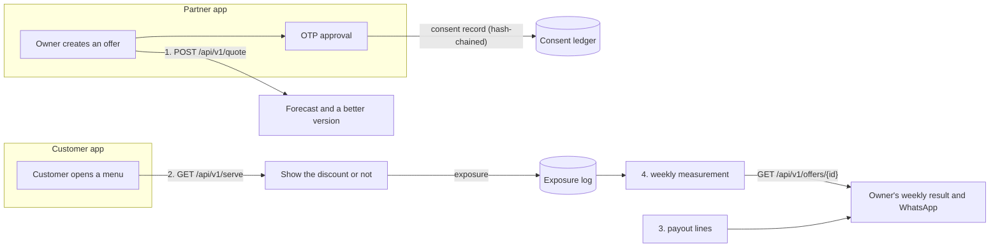
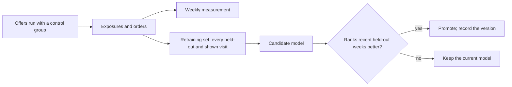

# How TrueLift is built

TrueLift adds four hooks to Zomato's existing restaurant offer flow. Each hook is one call to a small
service; nothing changes in how customers order. This page describes the service as it is in this
repository, and what would change inside Zomato.

## The four hooks

1. **Quote (before approval).** For the owner's offer, flat ("₹60 off") or a percentage with a cap,
   the service predicts each recent visitor's chance of ordering with and without it, adds up the
   extra orders and profit, and gives an 80% range. It compares about 34 versions of the same
   discount (who sees it, minimum order, time of day, Brand Pack) and suggests the best one, but
   never changes the discount size: that stays the owner's choice. A version is offered only if it
   has at least a 60% chance of making money.
2. **Serve (while it runs).** When a customer opens the menu, the decision is a table lookup (built
   when the offer is approved) plus a hash of (customer, offer) that holds out a random 1 in 10 of the
   eligible customers. The same hash, with its own salt, holds out 1 in 10 of the restaurant's
   regulars from the Brand Pack reward, so the reward is measured on its own.
3. **Payout.** The restaurant pays for its own offer; the weekly payout itemises discount, Brand
   Pack rewards, commission and GST. Zomato co-funds only where its own measurement shows a gain.
4. **Measure (every week).** The difference between customers who saw the offer and the held-out
   ones, adjusted by each visit's predicted no-offer outcome, combined with the model's forecast by
   how noisy each is. Verdicts: keep, too early, probably losing (a warning), pause (only on the
   offer's own always-valid evidence). Renewal after four weeks needs a new OTP
   (`POST /api/v1/offers/{id}/renew`): the owner sees what was measured, and the renewed offer keeps
   the same customers held out so the evidence keeps building. When either group has fewer than 20
   customers, the owner sees no order counts for the groups, only the estimate.

## Code map

| Module | Role |
|---|---|
| `truelift/api.py` | FastAPI routes under `/api/v1`, RFC 9457 errors, `/healthz`, `/readyz`, `/metrics` |
| `truelift/engine.py` | Quote, design search, decision tables, serving, weekly measurement and verdicts |
| `truelift/model.py` | Uplift model (two gradient-boosted classifiers), input allow-list, model bundle with checksum |
| `truelift/features.py` | Customer and restaurant features from order history, with fixed look-back windows |
| `truelift/assignment.py` | The hashed control groups (offer, Brand Pack, depth test), shared by serving and measurement |
| `truelift/store.py` | SQLite consent ledger (hash-chained) and exposure log |
| `truelift/monitoring.py` | Input drift (PSI) and weekly guardrails |
| `truelift/schemas.py`, `settings.py` | The typed request and response models (the contract in `docs/openapi.json`); configuration from `TRUELIFT_*` variables |
| `truelift/state.py`, `demo.py` | Per-visitor sessions and offers; the simulated weeks and payouts the demo shows |
| `truelift/i18n.py` | Owner texts in English, Hindi, Kannada and Gujarati, shared by the service and the page; the three drafts stay off until a native speaker reviews them |
| `truelift/sim.py` | The simulated market used for evaluation and the demo; never part of serving logic |
| `scripts/shadow_measure.py` | The shadow kit: measures offers from exposure and order logs in the event format of `docs/events/`, changing nothing |

## Speed and failure

Serving is a dictionary lookup and a hash, measured over HTTP by `scripts/bench_latency.py`
(`reports/latency.json`). If scoring fails while an offer's decision table is built, the table falls
back to the owner's own rule (everyone eligible sees the offer), every decision from it is flagged as
degraded, and the fallback is counted in `/metrics` (`truelift_serve_fallback_total`, which must stay
at zero). The control-group hash still applies, so the weekly measurement keeps working.

## The learning loop

Each week the fleet of running offers also recalibrates the measurement: two random halves of each
offer's customers show the real noise of its own estimate, and the spread of own estimates around the
model's shows the model's real error. No truth is needed for either. `scripts/experiments.py
retrain-loop` checks the promotion rule on the simulator.

## Inside Zomato

The service would read the same events Zomato already logs (menu opens, orders, offer approvals). The
model needs only order history: orders and visits by customer and restaurant over the last eight
weeks, never location, device or payment data. The quote and decision tables are computed in batch
(nightly or at approval); the only request-time work is the lookup in hook 2. The first step needs
no change to any customer's experience: a shadow holdout on offers that already run, measured by the
shadow kit from Zomato's own logs. `docs/integration_blueprint.md` lists the events, the rollout and
the size of the randomised pilot that would follow.
