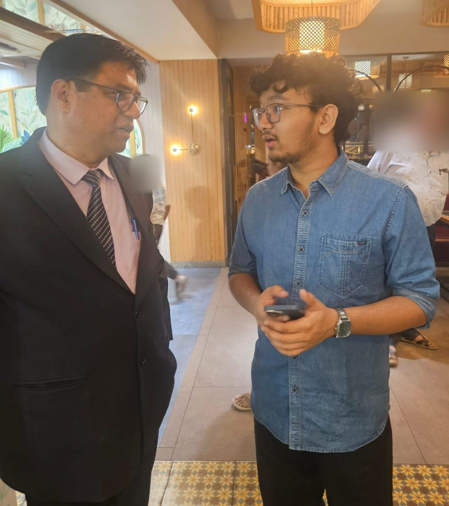
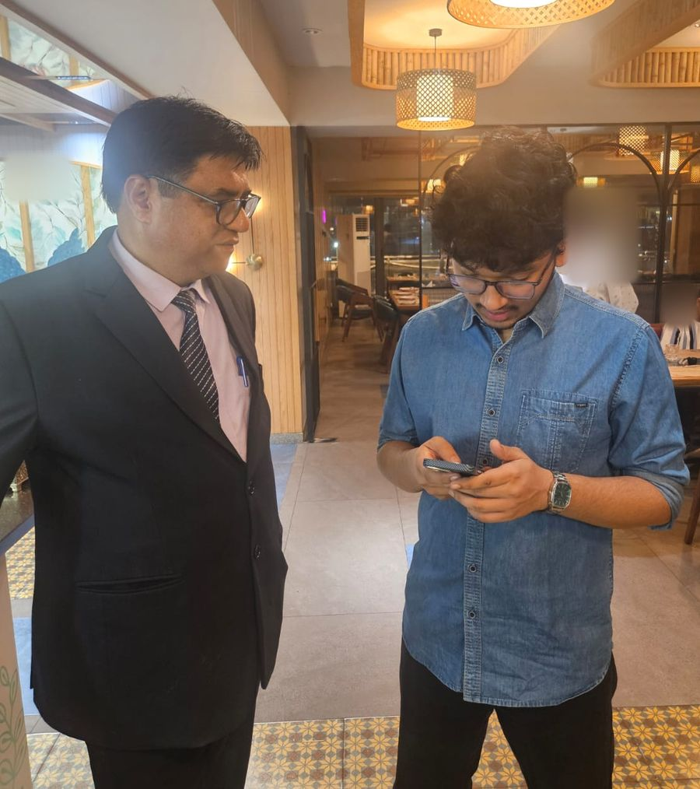

# Research with restaurant owners

**Status: one interview of six to eight done.** On 17 November 2026 a team member showed the demo
to the manager of a chain outlet in Gandhinagar. Its note is not written up yet, so the tables below
are still empty. This page holds the method and the tables the findings will go into. Nothing below
is a finding until a row is filled from a written interview note.

  
  

The first interview, 17 November 2026: a team member talks the manager through TrueLift, then shows
the demo on a phone. The photos are published with the manager's permission; other diners' faces
and the restaurant's name are blurred, and the files carry no metadata (decision D17).

## Why

TrueLift rests on a statement about what owners can see: offer reports count the orders that used
an offer, not the orders it added, so owners approve offers without knowing whether they pay. Three
facts in the write-up depend on what owners can show us:

1. Whether Zomato charges commission on the bill before or after the discount. At 15% off, an offer
   breaks even when 32 of every 100 orders using it are extra if commission is on the discounted
   bill, and 45 of 100 if it is on the full bill (`truelift/economics.py`, Money maths page).
2. What an offer report and the OTP approval screen show today.
3. Whether owners read a forecast with a range, and a weekly result, the way we intend.

## Who and where

Six to eight owners or managers of restaurants that take Zomato orders, mixed by size: two outlet
managers of chains, three or four independent restaurants, one or two cloud kitchens or counters.
Gandhinagar (Infocity, Kudasan, Sargasan) and Ahmedabad, starting with outlets the team already
orders from. Visit between 3 pm and 5 pm, when kitchens are quiet. List fifteen outlets to reach
eight (`field_research/target_outlets.md`). Two team members per visit: one asks, one writes.

## The conversation (15 minutes)

| Part | Minutes | What to do |
|---|---|---|
| Consent | 1 | Read the consent script (`field_research/consent_script.md`). Ask before any photo. |
| How they use offers | 4 | Questions 1, 2 and 5 of the question sheet |
| The OTP approval | 2 | Question 3. If the OTP flow has not reached them, note that; it is a finding. |
| Money | 3 | Questions 4 and 6. Ask to see one payout statement with customer details covered. |
| Reading TrueLift | 4 | The comprehension cards, then the demo on a phone, without help at first |
| Close | 1 | Question 7; ask for an introduction to one more owner |

Question sheets: `field_research/question_sheet_en.md`, and drafts in Hindi and Gujarati
(`question_sheet_hi.md`, `question_sheet_gu.md`) that a native speaker should check before use.
The phone runs the offline demo (`python scripts/build_offline.py`, then open
`dist/truelift-offline/index.html`), so a weak network does not matter.

## What to record

- One page per interview, written within the hour (`field_research/note_template.md`): type and
  size of the restaurant, rough weekly Zomato orders, the answers, exact phrases.
- For each comprehension card: read correctly unaided, correctly after one hint, or not understood.
  Alternate the two forecast wordings between owners (card 2A to odd-numbered interviews, 2B to
  even-numbered ones).
- Photos of screens only with permission, with customer names, phone numbers and the restaurant's
  name covered or cropped. Delete raw photos after cropping.
- A photo of the conversation itself only if the person agrees to appear in a public repository.
  Blur everyone else and any restaurant name, and strip the file's metadata, before it is committed
  to `field_research/photos/` (decision D17).

## How to report

Counts, never percentages ("5 of 8 owners"), and never beyond "the owners we met". Restaurants are
described, not named ("40-seat North Indian restaurant, Kudasan"). Quotes are short and
anonymous. A finding that changes the product is listed with the change it caused.

## Findings

One interview done (17 November 2026, the manager of a chain outlet in Gandhinagar). Its note is
not written up yet, so no row below is filled.

| # | Restaurant (described, not named) | Area | Rough Zomato orders a week | Offer report seen | Payout statement seen | Commission base | OTP approval seen |
|---|---|---|---|---|---|---|---|
| | | | | | | | |

| Comprehension item | Read correctly unaided | After one hint | Not understood |
|---|---|---|---|
| Card 1: today's report against TrueLift's weekly result | | | |
| Card 2A: forecast as a range | | | |
| Card 2B: forecast as a chance in ten | | | |
| Card 3: "1 in 10 customers will not see your offer" | | | |

Changes made because of what owners said: none yet.

## A wider, lighter signal

A five-question form (`field_research/short_form.md`) can go to any owners' group an interviewee
is willing to forward it to. It supplements the interviews; with fewer than twenty answers, report
counts only.
