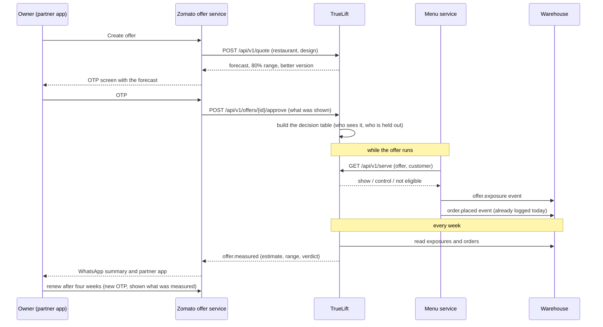

# How TrueLift would go into Zomato

This page says what Zomato's systems would call, what they would log, what Eternal would need to
supply, in what order TrueLift would be switched on, and what stops a bad rollout. The prototype
in this repository implements every call and log below against a simulated market; nothing here
has been run inside Zomato.

**Assumptions about Zomato's systems.** We have not seen them, so every interface below is written
as "a service that ...". We assume: an offer service that holds restaurant offers and the OTP
approval (since August 2026 a restaurant-funded offer starts only after the owner's OTP); a menu
service that knows which customer opened which restaurant's menu; an order service whose events
carry the discount and who funded it; a data warehouse with order history per customer and
restaurant; and an event bus. Where an assumption is wrong, the last section of this page lists
what would replace it.

## 1. The calls, in order

The quote and the decision table are computed in batch, off the customer's path. The only call on
the customer's path is the lookup: a dictionary read and a hash, with no model involved, so a
model failure can never reach a customer's menu. If the lookup does not answer in time, the menu
service uses a default (the owner's own rule) and the fallback is counted.

## 2. The contract

- The typed contract is [`docs/openapi.json`](openapi.json), generated from the service's models
  and checked by a test against what the service serves. Every response has an example.
- Errors are RFC 9457 problem details with a stable `type` for each failure. Approval and the
  weekly run accept an `Idempotency-Key`, so a retried request never approves or runs twice.
- Versioning: everything is under `/api/v1`; within a version only additive changes are allowed.
- Speed. Our budgets, which Zomato would replace with its own: the lookup within 5 ms at the
  99th percentile, the quote within 300 ms (it is shown to an owner, not on a customer's path),
  measurement in batch. The prototype's measured times are in `reports/latency.json` and on the
  Evidence page.

## 3. The events

Each event has a JSON Schema in [`docs/events/`](events/), wrapped in a CloudEvents 1.0 envelope
so that it fits an existing event bus. [`data/sample/events_example.jsonl`](../data/sample/events_example.jsonl)
holds one example of each, and a test checks them against the schemas.

| Event | Written by | What it carries |
|---|---|---|
| `offer.quoted` | TrueLift | draft, restaurant, design, forecast and range, model version |
| `offer.consented` | offer service | offer, design, the forecast (or, for a renewal, the evidence) shown, who pays, validity, OTP reference |
| `offer.exposure` | menu service | offer, customer, visit, week, assignment (show or control), decision-table and model version |
| `order.placed` | order service (exists) | order, visit, basket, discount, Brand Pack reward, part funded by Zomato |
| `offer.measured` | TrueLift | offer, week, extra orders and profit with range, weight on own data, verdict |
| `offer.lifecycle` | offer service | paused, stopped, renewed or expired, and the evidence it rests on |

The exposure event is the one that does not exist today. It must be written for held-out customers
as well as for those who see the offer: without the held-out visits there is no control group.

## 4. What Eternal would supply

| Needed | Why | If it is not available |
|---|---|---|
| Menu-open events with customer and restaurant | The unit the offer is shown or withheld on | Use cart or order-page events and measure at that step |
| Order history per customer and restaurant, last eight weeks | The model's inputs (no location, device or payment data) | Nothing replaces it |
| Offer catalogue with the funding split | Designs and the payout statement | Nothing replaces it |
| Commission terms per restaurant, and whether commission is charged before or after the discount | Restaurant profit | The standard rate, flagged on every figure |
| Food cost share | Restaurant profit | The owner's own figure, with a cuisine default |
| A way to hold out customers from one restaurant's offer | The control group | Only the forecast can run, with no measurement |

## 5. Switching it on

| Phase | What runs | Who is affected | Starts when | Ends when | Stops at once if |
|---|---|---|---|---|---|
| 0. Offline | Train on past logs; check that features reproduce and forecasts are calibrated | Nobody | Data access | Features match the warehouse; forecasts calibrated on past offers | – |
| 1. Shadow holdout | A small random holdout (2%) on offers owners already run, in one city; nothing shown to owners | 2% of eligible customers pay the normal price | Phase 0 done; holdout signed off | Sample-ratio checks pass; placebo offers give no false pauses; first estimates | A sample-ratio failure; complaints rise |
| 2. Measure | Forecast on the OTP screen and the weekly result, for a random half of 500 to 1,000 restaurants; 10% holdout | Owners in that half | Phase 1 done | Renewal rate, discount per extra order, owners' feedback | Orders per restaurant fall beyond an agreed bound |
| 3. Target | Owners in that half may let TrueLift choose who sees the offer | Customers of those restaurants | Phase 2 shows gains | Restaurant profit and platform-new orders against phase 2 | A fairness or complaint guardrail is breached |
| 4. Scale | City by city | – | Phase 3 shows gains | – | The same guardrails |

The weekly guardrails (sample ratio, forecast against measured, verdict mix, model error against
stated, decision-table age) and the input-drift check are implemented in `truelift/monitoring.py`;
their latest values are on the Operations tab.

## 6. The pilot as an experiment

Phase 2 is itself a randomised test, and its unit is the restaurant, because the owners' decisions
are what TrueLift changes. The main outcome is the share of offers renewed at the end of the
four-week approval; the others are discount per platform-new order, orders, and how confident
owners say they are.

`scripts/pilot_sample_size.py` gives the size with the usual two-proportion formula (written out in
the script). To detect a rise in renewals from 60% to 70% with 80% power at the 5% level (two-sided),
the pilot needs 356 restaurants in each half, 712 in all. The 60% is a placeholder: Eternal would
replace it with the real renewal rate. Customers choose between treated and untreated restaurants,
so restaurant-level effects are mixed with competition between them; randomising whole localities
avoids this but needs more restaurants, between 531 and 2,101 per half depending on how alike
restaurants in one locality are (`reports/pilot_sample_size.json`).

## 7. How it fails, and what then

| Failure | Effect | How it is seen | What happens |
|---|---|---|---|
| The scoring job fails | The decision table is not rebuilt | Table-age guardrail | The last table keeps serving; unseen customers get the default; alert |
| The lookup is slow | The menu waits | Client time-out | The default decision; counted in `truelift_serve_fallback_total` |
| The hash or its salt changes during an offer | The control group is mixed up | Sample-ratio check; assignment stability | The assignment function is versioned and never changes within an offer |
| Exposure events are lost | The estimate is biased | Exposures against menu opens, daily | Reconcile daily; widen the range when the loss passes a bound |
| An owner re-creates offers to shop for a good forecast | Choices made on noise | Quotes per approval | The range is always shown; quotes are rate-limited |
| One customer with several accounts | Sees both arms | Not detectable here | Stated as a limit |
| Competitors change their offers | The forecast drifts | Forecast against measured, weekly | Weekly recalibration across running offers |
| An estimate is confidently wrong | A wrong verdict | Placebo offers in production; a long-run holdout | Pauses need the offer's own always-valid evidence; a person reviews pauses at first |

## 8. Trying it on Zomato's own logs

`scripts/shadow_measure.py` takes two files in the shapes of `offer.exposure` and `order.placed`
and prints, for each offer and week, the extra profit and orders with an 80% range and a verdict,
using the same estimator as the service (customer-level noise, the always-valid pause boundary,
the sample-ratio check). It needs neither the service nor the model; with the model's per-visit
prediction in the exposure log it is also regression-adjusted, as the service is.
`data/sample/` holds such files for three simulated offers, written by
`scripts/make_sample_events.py`, and a test checks that the kit reproduces the service's own
estimate from them. An engineer at Eternal can therefore see in an afternoon what would have to be
exported, and run the measurement on a past offer that had a holdout.
